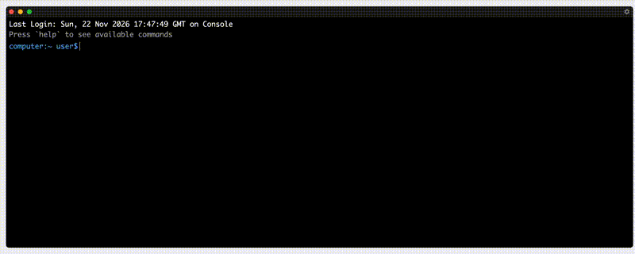

# react-terminal

[](https://github.com/zavjs/react-terminal/actions/workflows/ci.yml)
[](https://www.npmjs.com/package/@zavjs/react-terminal)


A browser terminal you can drop into any React app. It has a virtual filesystem, a real lexer (quotes, redirects), 14 Unix-style commands, themes, and an API for adding your own commands.

**[Live demo](https://zavjs.github.io/react-terminal/)**



## Use it for

- Interactive tutorials and docs for CLI tools
- A portfolio or landing page people can explore by typing
- Teaching shell basics without a real machine

## Install

```bash
npm install @zavjs/react-terminal
```

```tsx
import Terminal from '@zavjs/react-terminal';
import '@zavjs/react-terminal/dist/style.css';

export default function App() {
  return <Terminal username="ada" machineName="lovelace" />;
}
```

## Add your own commands

A command is a plain object. `execute` gets the raw arguments and the current state, and returns what changed. It never mutates anything.

```tsx
import Terminal, { type Command } from '@zavjs/react-terminal';

const whoami: Command = {
  name: 'whoami',
  description: 'whoami: who you are talking to',
  execute: () => ({ output: 'Henri, full-stack engineer. Try `ls projects`.' }),
};

<Terminal commands={[whoami]} initialTree={{ projects: { type: 'dir', contents: {} } }} />;
```

Return `{ tree }` to change files, `{ cwd }` to move, `{ output }` or `{ error }` to print, `{ clear: true }` to clear the screen.

## Built-in commands

`ls` `cd` `pwd` `mkdir` `touch` `cat` `echo` `rm -rf` `mv` `cp` `grep -inrv` `history` `clear` `help`

Plus `>` and `>>` redirects, brace expansion (`touch {a,b,c}.txt`), command history (up/down), Ctrl+C and Ctrl+L.

## How it works

```
input ─▶ lex() ─▶ parse() ─▶ { argv, redirects } ─▶ command.execute(argv, ctx) ─▶ applyRedirects() ─▶ new tree + output
```

- **One-pass lexer.** Quotes and operators are handled in a single pass that emits typed tokens. Adding pipes or `&&` means adding a token, not another parser.
- **Pure commands.** `runCommand` has no React in it, so every command is tested with plain inputs and outputs.
- **Immutable tree.** Each command returns a new filesystem tree, so history, undo and snapshots are cheap.
- **Thin UI.** `useTerminal` holds state; `<Terminal>` only renders.

The reasoning behind each design change is in [CHANGELOG.md](CHANGELOG.md).

## Props

| Prop | Type | Default |
| --- | --- | --- |
| `commands` | `Command[]` | built-ins only |
| `initialTree` | `Tree` | empty |
| `username`, `machineName` | `string` | `user`, `computer` |
| `onCommand` | `(command, result) => void` | none |
| `profiles`, `profile`, `onProfileChange` | themes | built-in profile |
| `settingsDisplay` | `'modal' \| 'drawer'` | `'modal'` |

## Development

```bash
npm install
npm run dev        # demo at localhost:5173
npm test           # vitest
npm run typecheck
```

## Roadmap

Pipes (`cat notes.txt | grep todo`), ANSI colors, and a `run()` API so a page can type commands into the terminal. See [backlog.md](backlog.md).

## License

MIT
